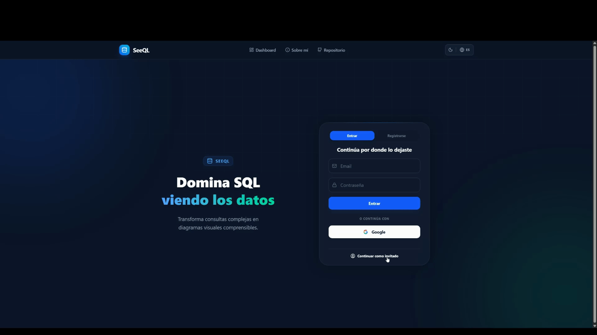
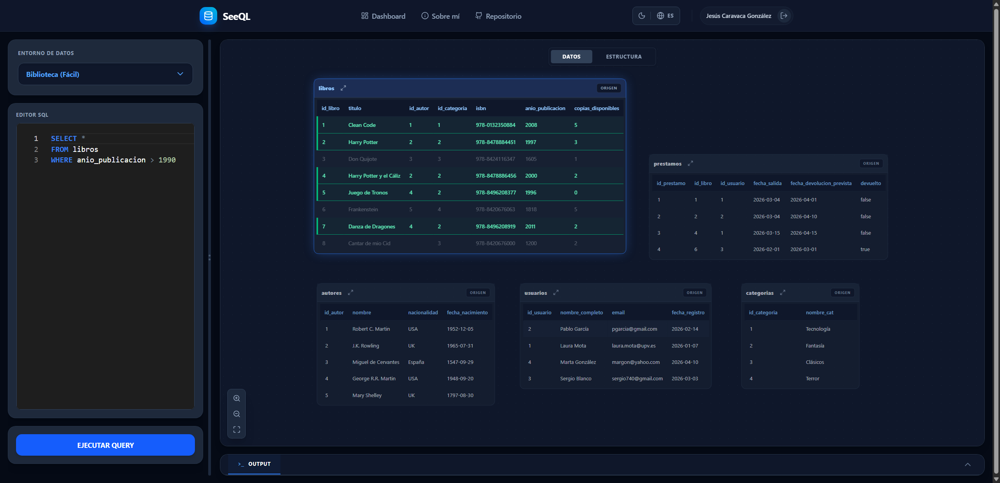
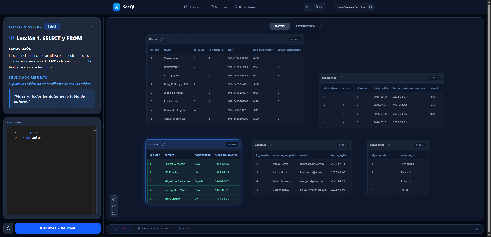
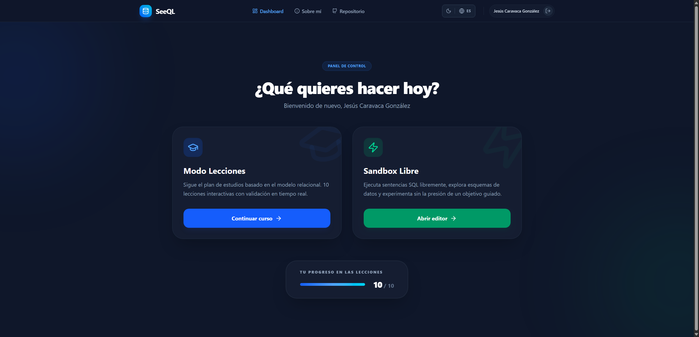
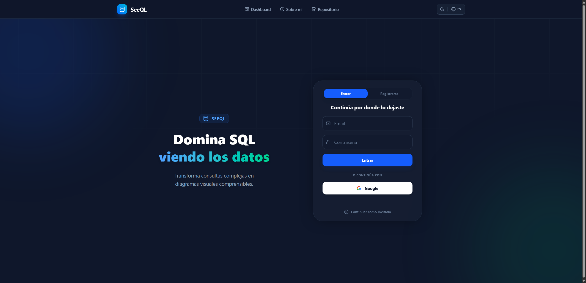
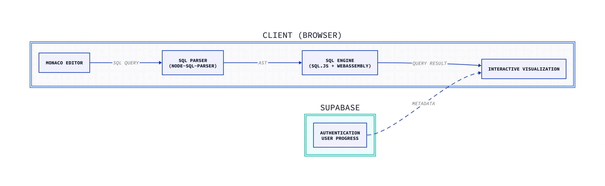

<div align="center">

# SeeQL

**Learn SQL by seeing how queries transform data.**

A visual SQL learning environment with an in-browser SQLite engine, guided lessons and an interactive sandbox.

[Live app](https://see-ql.vercel.app/) · [Video walkthrough](https://youtu.be/lvYT9PO54WY) · [Thesis](docs/thesis.pdf) · [My portfolio](https://jesuscaravaca.web.app/)




</div>

## The idea

Learning SQL on paper made it hard for me to connect a query with the rows it actually changes or selects. Setting up a database added friction before I could even practise. I built SeeQL to bring the editor, data and explanation into the same place.

Developed as my **Bachelor's thesis at Universitat Politècnica de València (UPV)**: **10/10, with an honours recommendation**.

## What you can do

- Run SQL against a SQLite database in the browser through `sql.js` and WebAssembly.
- Inspect tables, relationships, JOINs and filters through interactive diagrams.
- Follow guided lessons or explore sample datasets in the sandbox.
- Get learning-oriented feedback when a query contains an error.
- Save lesson progress with a Supabase account. The dashboard and sandbox also have guest routes.

Executing a query happens locally once the example data has loaded; it does not require a SQL execution request to a server. Initial dataset loading, authentication and progress storage still use Supabase.

## A closer look



<details>
<summary>More screenshots</summary>

### Guided lessons



### Dashboard



### Welcome screen



</details>

## How it works

```text
SQL query
  ├─ sql.js / SQLite / WebAssembly → query result
  └─ node-sql-parser → AST → React Flow visualisation

Supabase → sample schemas and data, authentication, saved progress
```

React and TypeScript coordinate the editor, local engine and visualisation. `node-sql-parser` supplies the syntax tree; the application turns it into the relationships and highlighted rows shown in React Flow. Monaco provides the query editor.

<details>
<summary>Architecture diagram</summary>



</details>

## Run locally

Use Node.js 22.12+ or Node.js 24 and npm.

```sh
git clone https://github.com/MagicNube/SeeQL.git
cd SeeQL
npm ci
```

Copy `.env.example` to `.env.local` and provide the URL and browser-safe anon key for **your own Supabase project**:

```dotenv
VITE_SUPABASE_URL=https://your-project.supabase.co
VITE_SUPABASE_ANON_KEY=your-public-anon-key
```

Use the public anon key, not a service-role key: Vite exposes these values to the browser.

```sh
npm run dev
```

Open the address printed by Vite. A valid Supabase configuration is required even for guest routes because the app initialises its client on startup and loads example datasets from it.

### Supabase setup status

The current app expects sample schemas, the `progreso_usuarios` table and the RPC functions `obtener_estructura_esquema` and `obtener_relaciones_esquema`. The repository includes example PostgreSQL datasets in [`database/postgres_backend/`](database/postgres_backend/) and their SQLite counterparts in [`database/sqlite_frontend/`](database/sqlite_frontend/), but does **not** yet contain a complete automated Supabase bootstrap. Cloning the repository and setting two environment variables alone does not provision that backend.

## Checks

```sh
npm test -- --run
npm run test:coverage
npm run build
```

## Documentation

The [Spanish thesis](docs/thesis.pdf) covers requirements, architecture, implementation decisions, testing and evaluation with students and teaching staff.

## License

MIT, as declared by the original project README. The standalone `LICENSE` file is not yet included in the repository.
